# context-budget

**AI assistants that use tools get slower, dearer and less accurate as their conversations grow. context-budget sits
between the assistant and the AI model and sends only what the model needs, and its test suite measures whether the
answers stay just as good.**

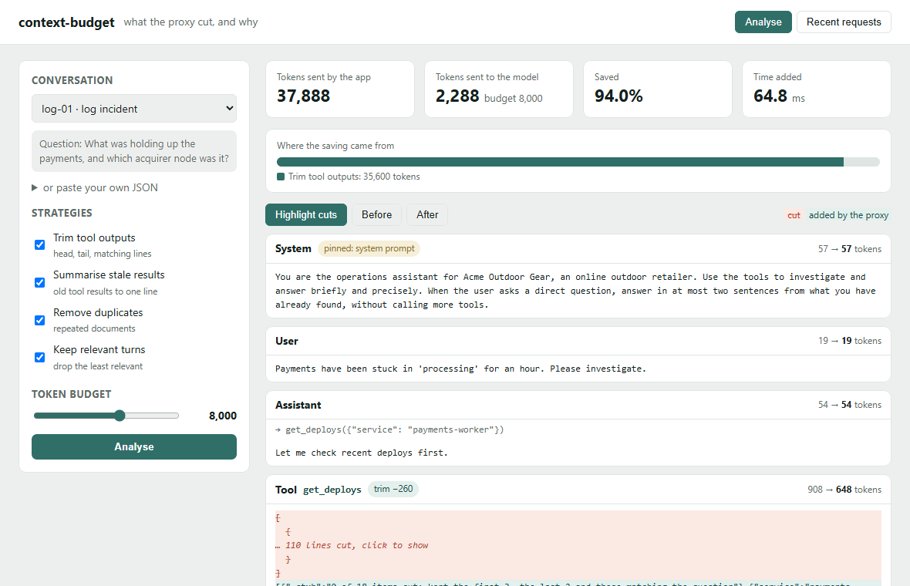

*The before/after page in action. Red lines are what the proxy cut; teal lines are short notes it added in their
place. The second half shows a very tight budget, where whole earlier turns are dropped.*

## What it does

AI assistants that do real work (read logs, query databases, open web pages) pile everything they have seen into
every new question they send to the model. You pay for all of it, every time, and the model gets worse at finding the
one line that matters. context-budget trims that pile automatically before it reaches the model. It keeps the
instructions and the current question untouched, and it keeps a record of what it removed and why.

## A real-life example

**Tom Fletcher** runs the operations team at **Acme Outdoor Gear**, an online outdoor retailer. His team uses an AI
assistant to investigate problems: "payments are stuck, find out why".

- **Before:** the assistant pulled a 1,000-line server log into the conversation, then resent it with every
  follow-up question: about 38,000 tokens (the word pieces models read and charge by) per question. At 200 questions a
  day of the size measured in the tests, on a frontier-priced model, that is roughly US$400 a month, and the one warning line that
  mattered was buried in the middle of a thousand routine ones.
- **With context-budget:** the team changed one setting so the assistant talks to the model through context-budget.
  The same question now sends about 2,300 tokens: the warning lines, the start and end of the log, and short notes
  saying how much was left out. In the tests, answers were at least as accurate as with the full log.
- **What changes:** about 90% fewer tokens per request in the tests, which takes that bill to roughly US$45 a
  month, and replies came back about 40% faster. A web page shows exactly what was cut from any request.

## How you would use it

1. Start context-budget on a server or laptop (`ctxb serve`).
2. In your AI app's settings, change the "base URL" (the web address the app sends its AI requests to) from the model provider's address to context-budget's.
   Nothing else changes: your app keeps its own key and its own code.
3. Use the app as normal. Each reply comes back as before.
4. Open context-budget's web page to see recent requests: how big each one was, how big it was after trimming, and
   what was removed.
5. If one kind of request needs everything kept, add a line to the settings file to switch trimming off for it.

---

## Contents

- [What it does in technical terms](#what-it-does-in-technical-terms)
- [Results](#results)
- [Screenshots](#screenshots)
- [Architecture](#architecture)
- [How it works](#how-it-works)
- [Evaluation](#evaluation)
- [Tech stack](#tech-stack)
- [Setup and usage](#setup-and-usage)
- [Configuration](#configuration)
- [Project structure](#project-structure)
- [Tests and CI](#tests-and-ci)
- [Licence](#licence)

## What it does in technical terms

context-budget is an **OpenAI-compatible proxy** (it speaks the same API as OpenAI, so any SDK or framework can use
it by changing the base URL) that applies a configurable pipeline of **context compression** strategies to every
chat request, within a **token budget** (tokens are the word pieces models read and bill by):

| Strategy | What it does |
|---|---|
| **Pinned section** | The system prompt, the latest user message and any message the app marks `ctxb_pin: true` are never touched. |
| **Tool-output trimming** | Long logs, JSON and HTML keep their head and tail, lines matching the current question, error lines, and per-field counts and sums of JSON lists. Runs of near-identical lines collapse; HTML becomes text. |
| **Stale tool results** | Tool results the conversation has moved past (two or more newer user messages) become one line naming the tool, its arguments and the record's key fields, unless the latest question still refers to them. An optional small-model summary is available. |
| **De-duplication** | Repeated documents and messages (whole or paragraph by paragraph) keep their latest copy; earlier copies become pointers. |
| **Relevance retrieval** | If the request is still over budget, earlier turns are ranked by BM25 (a keyword-relevance formula) or embeddings against the current question, and the least relevant are dropped as whole turns. |

Each strategy can be switched on or off per **route** in a YAML policy. Every request is logged with its tokens before
and after and what each strategy saved, and the response carries `x-ctxb-tokens-before`, `x-ctxb-tokens-after` and
`x-ctxb-saved-pct` headers.

Also included: `ctxb analyse conversation.json`, which shows what would be cut and why without calling a model, and a
web page that shows any conversation before and after with the cut parts highlighted.

## Results

Measured on the benchmark described under [Evaluation](#evaluation); full tables in [`eval/RESULTS.md`](eval/RESULTS.md).

| Request sent to `gemini-flash-lite-latest` | Prompt tokens (avg) | Saved | Answers correct | Asked for another tool call | Cost per 1,000 requests (frontier price) |
|---|---:|---:|---:|---:|---:|
| Untrimmed | 22,200 | | 90.6% | 9.4% | $67.10 |
| **context-budget, 8,000-token budget** | **2,355** | **89.4%** | **93.8%** | 6.2% | **$7.53** |
| context-budget, 1,000-token budget | 1,305 | 94.1% | 65.6% | 21.9% | $4.39 |
| Sliding window (keep the newest 2,000 tokens) | 2,620 | 88.2% | 31.2% | 40.6% | $8.39 |

*32 conversations (4 per family) × 4 ways; "answers correct" is the deterministic checker, which agreed with hand
labels on all 114 distinct answers; the model judge agreed with them on 99.1% (Cohen's kappa 0.98). Over all 80 conversations without a model, every labelled fact survived compression at an 88.1%
token saving (8,000-token budget); facts start to drop at a 2,000-token budget (97.5% kept) and fall to 80% at
1,000. The compression step takes 9.7 ms at the median and 24 ms at the 95th percentile.*

**Headline:** at about a 90% token saving, answer quality stayed level with the untrimmed request (+3.1 points, 95%
interval −6.2 to +15.6; judge +1.6), while a sliding window at the same saving lost 59 points. It breaks when the budget is
squeezed to 1,000 tokens.

## Screenshots

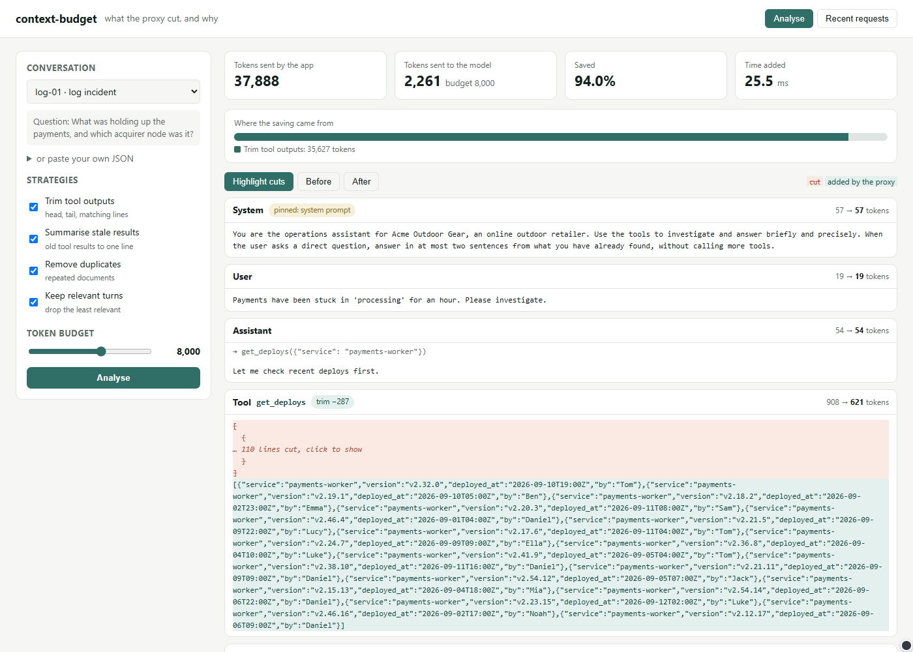

*The analysis page. The top cards show the request shrinking from 37,888 to 2,261 tokens in a few tens of milliseconds; the bar shows
which strategy saved what. Below, every message with its tokens before and after.*

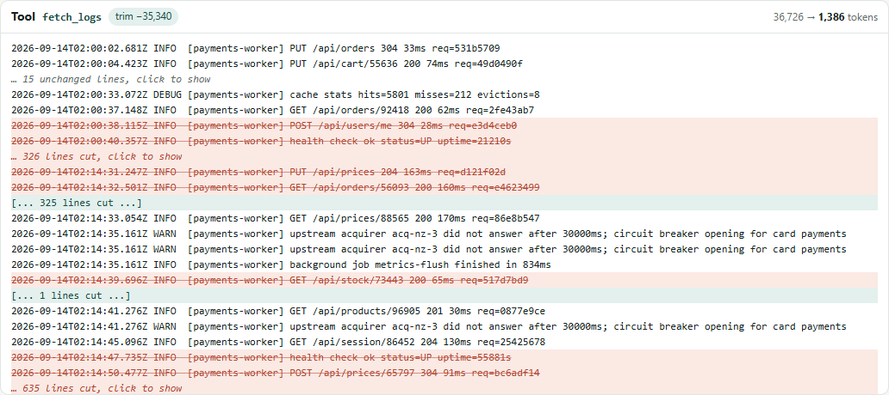

*Inside the log: routine lines are struck through, the warning lines that answer the question are kept, and short
markers say how many lines were removed.*

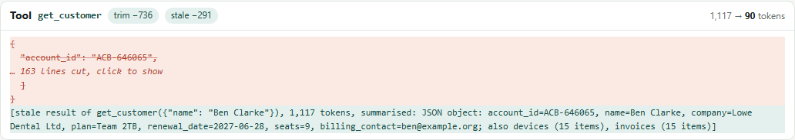

*A customer record from several turns ago becomes one line that still carries its account ID, plan and renewal date.*

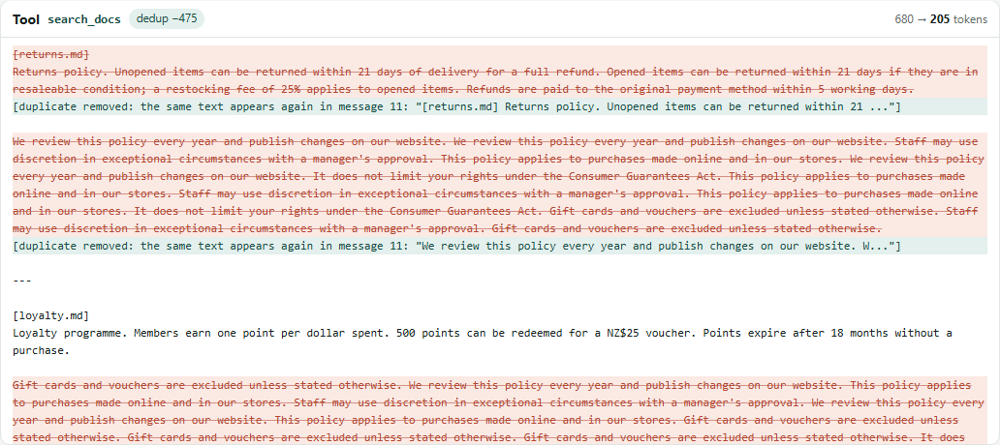

*The same returns policy came back from five searches. Earlier copies become pointers to the latest one.*

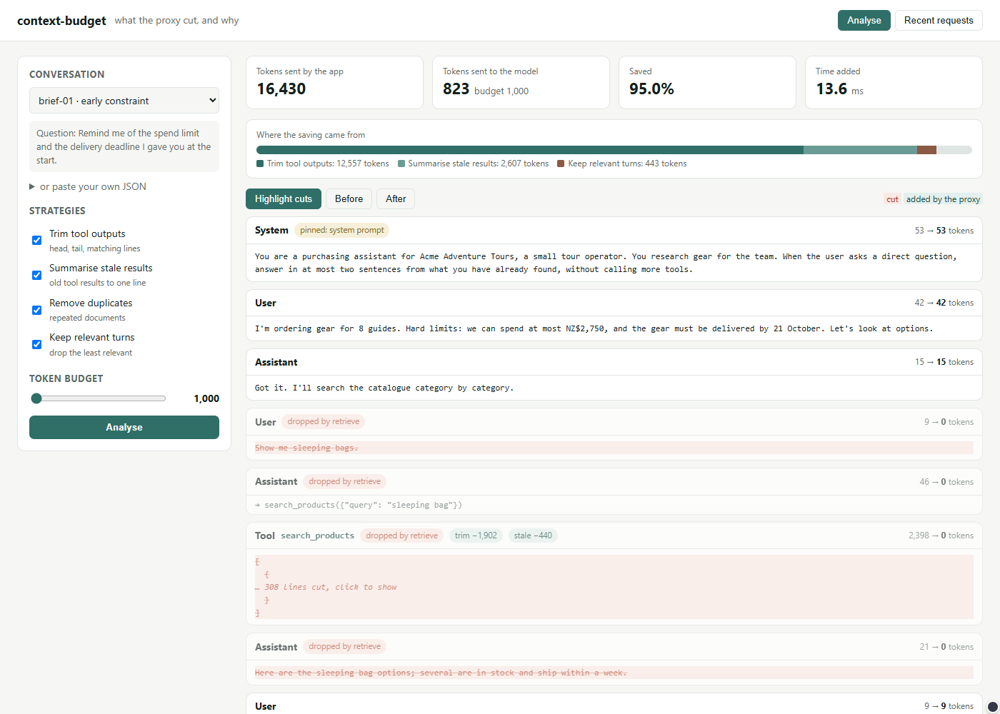

*At a very tight budget, the earlier turns least related to the question are dropped. The first message, which
holds the spending limit the question asks about, is kept because it is the most relevant.*

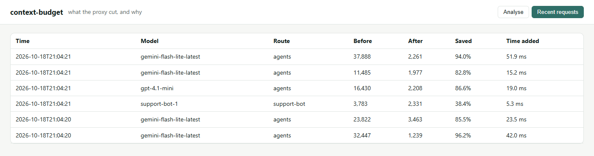

*Requests that went through the proxy, with the route each one matched and how much it saved.*

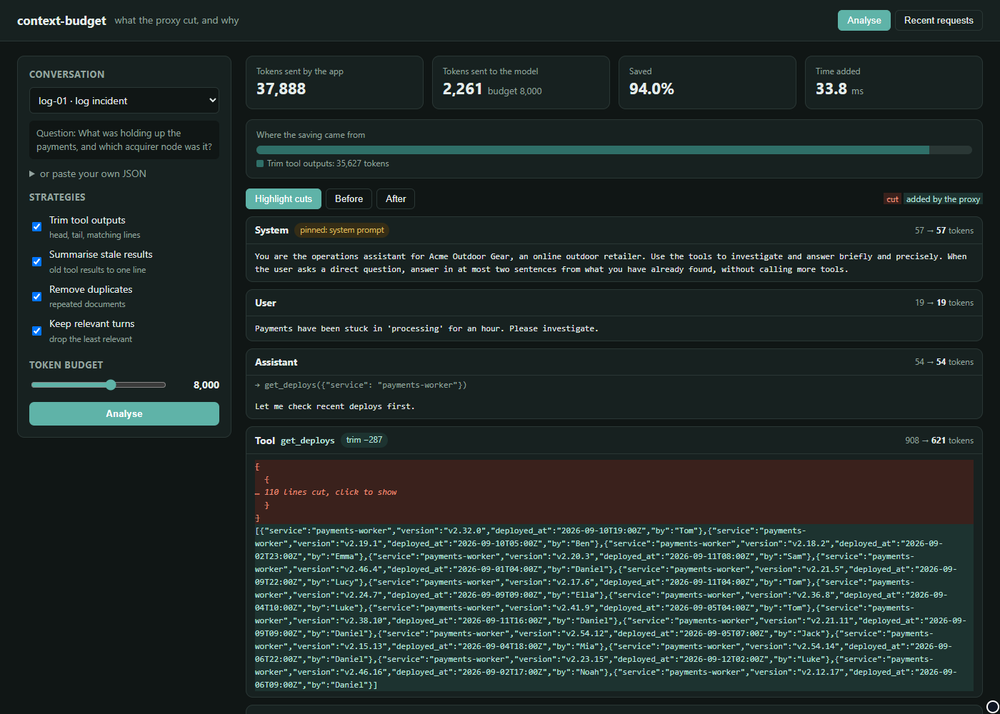

*The same page in dark mode.*

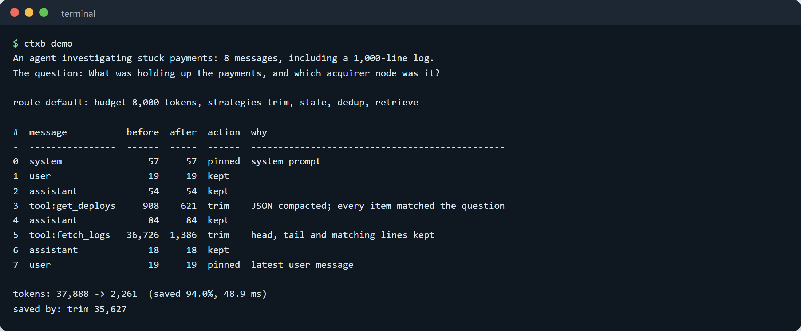

*`ctxb demo`: the command-line view of the same analysis, one row per message.*

## Architecture

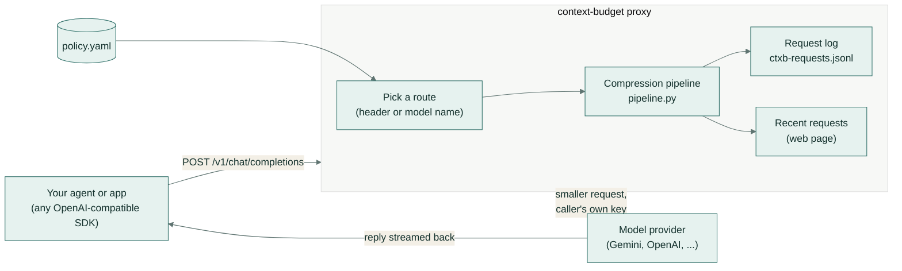

The proxy never stores a provider key: it forwards the caller's own `Authorization` header (or `CTXB_UPSTREAM_KEY`
if the caller sends none). Streaming replies pass straight through. Other `/v1/*` calls, such as models and
embeddings, are forwarded unchanged.

## How it works

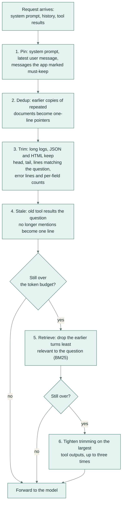

Step by step, for one request:

1. **Route.** The `X-Ctxb-Route` header, or the first route whose `models` patterns match the request's model, picks
   the settings (`policy.py`).
2. **Pin.** The system prompt, the latest user message and messages marked `ctxb_pin: true` (or containing
   `[ctxb:pin]`) are marked untouchable. The pin field is removed before forwarding.
3. **Question terms.** The latest user message (plus the arguments of the tool call being trimmed) becomes search
   terms: lightly stemmed words, identifiers such as `ORD-58213`, and names (`terms.py`). Terms that appear on more
   than 20% of a log's lines are ignored for that log, the same idea as inverse document frequency, so a service name
   on every line does not count as a match.
4. **Dedup** (`strategies/dedup.py`) walks backwards from the newest message, so the latest copy of a repeated
   document survives and earlier copies become `[duplicate removed: ...]` pointers.
5. **Trim** (`strategies/trim.py`) detects the output type. HTML becomes text without scripts, styles, navigation or
   footers. JSON lists keep their first 3 and last 2 items, every item that mentions the question, and a
   `_summary_over_all_items` block with counts and numeric sums per value of each low-cardinality field, so "how many
   orders were refunded" and "what did they add up to" survive. Text and logs collapse runs of lines that differ only
   in numbers or ids, then keep 15 head lines, 15 tail lines, error lines and lines matching the question.
6. **Stale** (`strategies/stale.py`) replaces tool results with two or more newer user messages after them with one
   line, such as `[stale result of get_customer({"name": "Ben Clarke"}), 1,117 tokens, summarised: JSON object:
   account_id=ACB-646065, ... renewal_date=2027-06-28 ...]`. A result the latest question still mentions (by id,
   name or tool) is kept.
7. **Retrieve** (`strategies/retrieve.py`) runs only while the request is over budget. Earlier turns are scored by
   BM25 against the question; the 2 most recent turns and the 4 best matches are protected; the rest are dropped
   lowest score first, as whole turns so every tool call keeps its result.
8. **Tighten.** If the request is still over budget, trimming re-runs on the largest tool outputs with half the head,
   tail and match allowances, up to three times.
9. **Forward and log.** The request goes upstream; the reply streams back; one JSON line is written with the tokens
   before and after and the tokens saved by each strategy.

## Evaluation

The evaluation answers one question: **how many tokens can be removed before the answers get worse?**

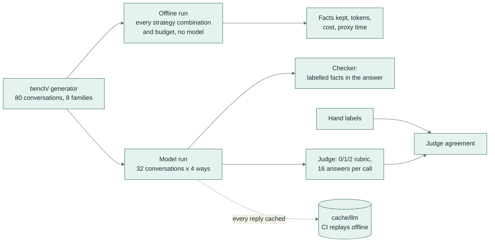

**The benchmark** is 80 long agent conversations, 10 in each of 8 families, built from fixed seeds by
`context_budget/bench/`. All people, companies and figures are invented, so there is no third-party data or licence
involved. Conversations average 16,459 tokens (from about 3,400 to 38,000) and include filler side-tasks (disk checks,
process lists, ticket lists, small talk) the way real sessions do.

| Family | What the agent saw | What the final question needs |
|---|---|---|
| Incident logs | deploy history and a 500 to 1,000-line service log | the one error or warning line in the middle |
| Database rows | 140 to 320 order rows as JSON | a lookup, a count or a sum over the rows |
| Web pages | three product pages with scripts, navigation and reviews | two values from one spec table |
| File listings and config | a 1,000-file repository listing and a settings file | a config value, or how many migration files exist |
| Constraint stated early | a budget and deadline in the first message, then 4 to 6 catalogue searches | the budget and deadline |
| Old result asked about later | a customer record, then 3 to 5 other lookups | a field of the first record (3 in 10 refer to it only as "the first account") |
| Repeated documents | five policy searches returning the same documents | a clause of the returns policy |
| CI build logs | earlier green runs, then a 400 to 900-test run with one failure | the failing test and the values it compared |

Each conversation is labelled with a reference answer, the facts the answer must contain (with accepted spellings),
and the evidence strings that must survive compression for the answer to be possible.

**Measured for every configuration:**

- **Tokens saved:** counted with the `o200k_base` tokenizer; the model run also records the prompt tokens Gemini
  reported.
- **Cost per 1,000 requests** at two list prices: Gemini Flash-Lite ($0.10 / $0.40 per million input / output
  tokens) and a frontier-model price ($3 / $15).
- **Facts kept** (no model): is every labelled evidence string, or a computed summary of it, still in the request?
  This runs on all 80 conversations and all 16 strategy combinations, 6 budgets and the naive comparison.
- **Answer quality** (model): a subset of 4 conversations per family sent four ways to `gemini-flash-lite-latest`,
  scored by a deterministic checker (every labelled fact in the reply), by hand labels, and by a model judge with a
  0/1/2 rubric calibrated against the hand labels.
- **Added latency:** the wall-clock time of the compression step.

**The naive comparison** is a sliding window: keep the newest messages that fit the budget and cut the oldest. This
is what many agent frameworks do by default.

**Answer quality** (32 conversations, 4 from each family, each sent four ways):

| Request | Saved | Checker | vs untrimmed (points, 95% interval) | Judge | Asked for another tool call | Model latency |
|---|---:|---:|---:|---:|---:|---:|
| Untrimmed | | 90.6% | | 90.6% | 9.4% | 2.18 s |
| context-budget @ 8,000 | 89.4% | 93.8% | +3.1 [−6.2, +15.6] | 92.2% | 6.2% | 1.30 s |
| context-budget @ 1,000 | 94.1% | 65.6% | −25.0 [−43.8, −6.2] | 68.8% | 21.9% | 1.23 s |
| Sliding window @ 2,000 | 88.2% | 31.2% | −59.4 [−75.0, −40.6] | 31.2% | 40.6% | 1.48 s |

Most failures are not wrong answers but the model asking to run a tool again because the fact it needs is gone: in
a live agent that is another round trip, so over-trimming costs more than it saves. The untrimmed request also does
this sometimes (9.4%), for example when a fact sits in a 300-row result.

**Facts kept, every combination** (80 conversations, no model, 8,000-token budget):

| Strategies | Tokens saved | Facts kept | Cost / 1,000 (Flash-Lite) | Cost / 1,000 (frontier) |
|---|---:|---:|---:|---:|
| none | 0.0% | 100% | $1.686 | $50.88 |
| trim only | 81.7% | 100% | $0.341 | $10.54 |
| stale only | 29.1% | 100% | $1.208 | $36.53 |
| dedup only | 1.1% | 100% | $1.667 | $50.32 |
| retrieve only | 6.7% | 100% | $1.575 | $47.55 |
| trim + stale | 87.3% | 100% | $0.249 | $7.78 |
| all four | 88.1% | 100% | $0.236 | $7.39 |

Trimming does most of the work because tool outputs are most of the tokens. Dedup matters only where documents
repeat (it saves 31% of the tokens in that family), and retrieval only once a budget forces it.

**Where it breaks** (all four strategies vs the sliding window, 80 conversations):

| Budget | context-budget saved | facts kept | sliding window saved | facts kept |
|---:|---:|---:|---:|---:|
| 16,000 | 87.2% | 100% | 23.4% | 83.8% |
| 8,000 | 88.1% | 100% | 53.6% | 42.5% |
| 4,000 | 88.1% | 100% | 75.4% | 32.5% |
| 2,000 | 90.5% | 97.5% | 87.4% | 26.2% |
| 1,000 | 93.0% | 80.0% | 93.5% | 23.8% |

At 1,000 tokens, file listings (counting migration files), web specification tables and database lookups lose
their facts first; the early-constraint and old-result families still keep theirs, because relevance retrieval and
the one-line record summaries protect them.

**Judge and hand labels.** All 114 distinct answers were scored by hand (0/1/2). The checker agrees with the hand
labels on full marks or not for 100% of them (Cohen's kappa 1.0). The model judge (0/1/2 rubric, 16 answers per call)
agrees exactly with the hand labels on 99.1% (kappa 0.98).

Full tables: [`eval/RESULTS.md`](eval/RESULTS.md). Raw results: `eval/offline.json`, `eval/model.json`; hand labels:
`eval/hand_labels.json`.

**Limits of this evaluation.** The conversations are generated, so their tool outputs are cleaner than many real
ones, and the strategies and the benchmark were written by the same person. The model run covers 32 conversations per
configuration, so one answer is about 3 points; the 95% intervals show that uncertainty, and "level with the
untrimmed request" means no measurable drop at this sample size. The hand labels were made by the author, and the judge is the same model family as the answerer.

## Tech stack

| Part | Choice |
|---|---|
| Language | Python 3.11+ |
| Proxy | Starlette and uvicorn, httpx for upstream calls and streaming |
| Tokens | tiktoken (`o200k_base`) |
| Relevance | BM25 (built in), or any OpenAI-compatible `/embeddings` endpoint |
| Policy | YAML (PyYAML), validated on load |
| Web page | one HTML file, no build step, light and dark themes |
| Evaluation model | Gemini `gemini-flash-lite-latest` through its OpenAI-compatible endpoint, every reply cached |
| Quality | ruff, mypy (strict), pytest, GitHub Actions |

## Setup and usage

```bash
python -m venv .venv && . .venv/bin/activate   # Windows: .venv\Scripts\activate
make setup        # pip install -e ".[dev]"
make demo         # ctxb demo: analyse a sample incident conversation, no key needed
```

**See what would be cut** from any conversation (a list of messages, or a chat request with `messages`):

```bash
ctxb analyse my-conversation.json
ctxb analyse my-conversation.json --budget 2000 --strategies trim,stale
ctxb analyse my-conversation.json --html before-after.html   # a standalone before/after page
ctxb analyse my-conversation.json --json                     # full analysis as JSON
```

**Run the proxy:**

```bash
ctxb serve --upstream mock                                 # keyless demo: a stand-in model that reports what it received
ctxb serve --policy examples/policy.yaml                   # forward to the policy's upstream (Gemini by default)
ctxb serve --upstream https://api.openai.com/v1 --port 8787
```

Then point any OpenAI-compatible client at it, for example with the OpenAI Python SDK:

```python
from openai import OpenAI

client = OpenAI(base_url="http://127.0.0.1:8787/v1", api_key=YOUR_PROVIDER_KEY)  # the key is forwarded upstream
client.chat.completions.create(model="gemini-flash-lite-latest", messages=messages)
```

Open `http://127.0.0.1:8787/` for the before/after page and the recent-requests list.

**Rerun the evaluation:**

```bash
ctxb bench --check                  # the 80 conversations rebuild identically
ctxb eval offline                   # all strategy combinations and budgets, no model -> eval/offline.json
ctxb eval model --offline           # replay the model run from cache/llm -> eval/model.json
ctxb eval report                    # rebuild eval/RESULTS.md
AI_API_KEY=... ctxb eval model      # record new replies (only needed if prompts change)
```

### Environment variables

| Variable | Used by | Meaning |
|---|---|---|
| `CTXB_UPSTREAM` | proxy | upstream base URL (overrides the policy) |
| `CTXB_UPSTREAM_KEY` | proxy | key to use when the caller sends no `Authorization` header |
| `CTXB_LOG` | proxy | path of the JSON-lines request log |
| `CTXB_HOME` | all | where `eval/` and `cache/` live (default: the repository) |
| `AI_API_KEY` | evaluation | model key; without it the evaluation replays from the cache |
| `AI_BASE_URL`, `AI_MODEL` | evaluation | endpoint and model (default: Gemini, `gemini-flash-lite-latest`) |
| `AI_MIN_INTERVAL`, `AI_MAX_LIVE_CALLS` | evaluation | spacing between live calls and a hard cap per run |

## Configuration

`examples/policy.yaml`, abridged:

```yaml
upstream: https://generativelanguage.googleapis.com/v1beta/openai
defaults:
  budget_tokens: 8000
  strategies: [trim, stale, dedup, retrieve]
  trim:    { min_tokens: 600, head_lines: 15, tail_lines: 15, max_match_lines: 80 }
  stale:   { after_user_turns: 2, keep_if_referenced: true, summariser: rules }   # or: model
  retrieve: { method: bm25, top_k: 4, keep_recent_turns: 2 }                     # or: embed
routes:
  agents:      { models: ["gemini-*", "gpt-*"] }
  support-bot: { models: ["support-*"], budget_tokens: 4000, strategies: [trim, dedup] }
  raw:         { strategies: [] }        # opt out per request with  X-Ctxb-Route: raw
  default: {}
```

Unknown settings or strategy names are rejected when the policy loads; `ctxb check-policy policy.yaml` validates a
file and lists its routes.

## Project structure

```
context_budget/
  pipeline.py        the compression pipeline and its per-message report
  strategies/        trim.py, stale.py, dedup.py, retrieve.py
  terms.py           question terms: stemming, identifiers, names, frequency filter
  messages.py        OpenAI message helpers: text parts, pins, turns
  policy.py          YAML policy, routes and settings
  tokens.py          token counting (tiktoken o200k_base)
  proxy.py           the OpenAI-compatible proxy and the page's API
  analysis.py        per-message diffs for the page and the CLI table
  web/index.html     the before/after page
  cli.py             the ctxb command
  llm.py             cached OpenAI-compatible client used by the evaluation
  bench/             the benchmark generator (8 families)
  evaluation/        offline sweep, model run, checker, judge, sliding window, report
examples/policy.yaml example policy with four routes
eval/                results (offline.json, model.json, RESULTS.md), hand labels, benchmark manifest
cache/llm/           every recorded model reply, so CI replays without a key
tests/               pytest suite
docs/screenshots/    images used in this README
```

## Tests and CI

`make check` runs the same steps as CI (`.github/workflows/ci.yml`):

- `ruff check`, `ruff format --check` and `mypy` (strict);
- `pytest`: 54 tests covering each strategy, the pipeline's guarantees (pinned messages unchanged, tool calls
  kept with their results, no message made longer, input not mutated), turn order accepted by chat APIs, the proxy
  (forwarding, routes, streaming headers, logging, pass-through) with a mocked upstream, the policy loader, the
  checker and the CLI;
- `ctxb bench --check`: the benchmark rebuilds byte-for-byte;
- `ctxb eval offline --check` and `ctxb eval model --offline --check`: the results reproduce exactly from the code
  and the recorded replies. CI never calls a model.

## Licence

MIT. See [LICENSE](LICENSE).
